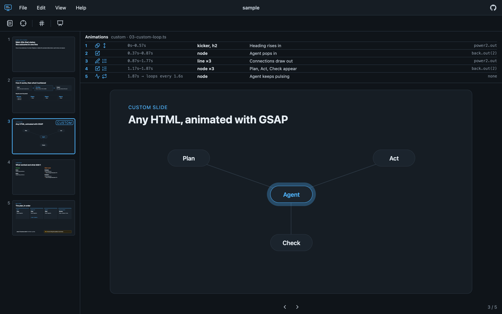

# Presentation Viewer

A slide viewer for presentations kept as plain files: a folder of numbered HTML slides, each with an optional
[GSAP](https://gsap.com) animation. Open the folder, see every slide and every animation step, present it, and export
it as a single HTML file or a PDF.



**Try it:** [presentation.viewer.bitzas.dev](https://presentation.viewer.bitzas.dev) asks which presentation
to open: drop your own folder on it, which is read in your browser and never uploaded, or try the sample.

## What it does

- **Slide list** with a live preview of every slide.
- **Animation list** under the slide: each step of the slide's animation with its timing, targets and icons.
- **Present** in the browser window, with speaker notes in a separate window, a laser pointer, slide numbers, and a
  pen, highlighter and eraser for drawing on the slide. Animation steps can wait for a click or →, one at a time;
  ← takes a step back and ↑ ↓ skip to the previous or next slide. Pop-ups lay a picture over the slide on its own
  click.
- **Export** to one self-contained HTML file that plays anywhere, or to a PDF with one slide per page (plus a page
  for each pop-up).
- **Slide Creation Prompt** (in the menu): a ready-made prompt that has an AI agent write a whole presentation in this
  format.
- Works on desktops and tablets; on a phone it shows the slides as a scrolling list.

## Run it on your computer

You need [Node.js 24](https://nodejs.org) and [pnpm](https://pnpm.io). The PDF export uses your installed Google
Chrome, and the folder picker and save dialogs are the macOS ones (elsewhere, drop a folder onto the app instead).

```bash
git clone https://github.com/SteliosHD/presentation-viewer.git
cd presentation-viewer
pnpm install
pnpm dev                                   # opens the sample presentation
node bin/presentation-viewer.ts ../my-talk # opens your own presentation folder
```

The viewer runs at http://localhost:4747 and reloads whenever a slide or the theme changes.
Add `--port 5000` to use another port, or `--no-open` to skip opening the browser.

To get a `presentation-viewer` command you can run from any folder, run `pnpm link --global` once in this folder.

## Make a presentation

A presentation is a folder like this:

```
my-talk/
  theme.css           your colours, optional
  slides/
    01-title.html     one slide; the number sets the order
    02-agenda.html
    02-agenda.ts      that slide's own animation, optional
  images/             pictures the slides use, optional
```

The title is the folder's name; click it above the slide to rename it (the new name is kept in your browser and
goes into exports). Each slide is one `<section class="slide">` designed for a 1200×675 canvas. Copy `sample/` to start, or have an
AI agent write one: in the Open dialog, **Create one with an AI agent** asks for a folder and three details (topic,
audience, length), then writes a starter folder there (the agent's brief as `AGENTS.md`, a theme to fill in
and a welcome slide), copies the brief and opens the folder, so each slide shows up as the agent saves it. Chrome,
Edge and the local viewer write the folder directly; other browsers download it as a .zip. The brief has the agent
ask about style and content and agree an outline with you before it writes anything.

## Personalize your viewer

Everything visual lives in a few plain files, so you can change it yourself or ask an AI agent to.

| To change                                                          | Edit                                                                                                                                     |
| ------------------------------------------------------------------ | ---------------------------------------------------------------------------------------------------------------------------------------- |
| Colours and fonts of slides                                        | `app/src/theme.css`. The brief at the top explains each token. A presentation's own `theme.css` overrides it for that presentation only. |
| Colours, fonts and corners of the viewer itself                    | `app/src/ui-theme.css`. Slides never use these, so any slide reads as it will on the projector.                                          |
| Slide layouts (boxes, columns, steps, callouts)                    | `app/src/slides.css`                                                                                                                     |
| The viewer's own look (floating menu, slide list, toolbar, modals) | `app/src/app.css`                                                                                                                        |
| Keyboard shortcuts                                                 | `app/src/shortcuts.ts`. The key handler, tooltips and notes window all read this one list.                                               |
| Icons that describe animation steps                                | `ICONS` in `app/src/animations.ts`                                                                                                       |
| The sample presentation                                            | `sample/`                                                                                                                                |
| The prompt for AI agents                                           | `app/src/prompt-dialog.ts`                                                                                                               |

**With an AI agent:** open this folder in Claude Code, Codex or a similar agent and describe the change you want,
such as "make the accent colour green" or "add a two-column layout with an image on the left". Agents find their
instructions in [`AGENTS.md`](AGENTS.md), which covers how slides and animations work, how to annotate animation steps
with icons, and the project's conventions.

**Your own copy online:** the project deploys to [Vercel](https://vercel.com) as it is (`vercel.json` sets it up).
Any static host works too: `pnpm build:web` writes the site to `dist/`.

**Your own landing page, credits or analytics:** write a site add-on, a module that default-exports the hooks in
[`app/src/site.ts`](app/src/site.ts), and pass it with `--site <file>` to `node server/build-web.ts` or the
`presentation-viewer` command. The tool itself stays unchanged, so you can keep pulling updates.

## How it's built

- **No UI framework:** plain TypeScript and the DOM, about 2,000 lines across small modules in `app/src/`.
- **[Vite](https://vite.dev)** runs the local viewer and builds the hosted site. A small Vite plugin
  (`server/presentation.ts`) serves the open presentation and live-reloads it.
- **[GSAP](https://gsap.com)** for slide animations; the viewer reads each timeline to list its steps.
- **[Lucide](https://lucide.dev)** icons.
- **Exports:** [vite-plugin-singlefile](https://github.com/richardtallent/vite-plugin-singlefile) bakes everything into
  one HTML file. PDFs come from Chrome through [Playwright](https://playwright.dev) locally, and from
  [html-to-image](https://github.com/bubkoo/html-to-image) and [jsPDF](https://github.com/parallax/jsPDF) in the
  hosted version.
- **[Sucrase](https://github.com/alangpierce/sucrase)** turns a dropped folder's TypeScript animations into
  JavaScript in the browser.
- **Tooling:** TypeScript 6, ESLint with typescript-eslint, [oxfmt](https://oxc.rs) for formatting, pnpm.

```
app/          the viewer: index.html, src/ (TypeScript and CSS), favicon
server/       the local server plugin, exports, macOS dialogs, hosted build
bin/          the presentation-viewer command
sample/       the sample presentation
```

## Develop

```bash
pnpm typecheck
pnpm lint
pnpm format        # or pnpm format:check
pnpm build:web     # the hosted site, in dist/
```

## License

[MIT](LICENSE). Use it, change it, and share your version.
